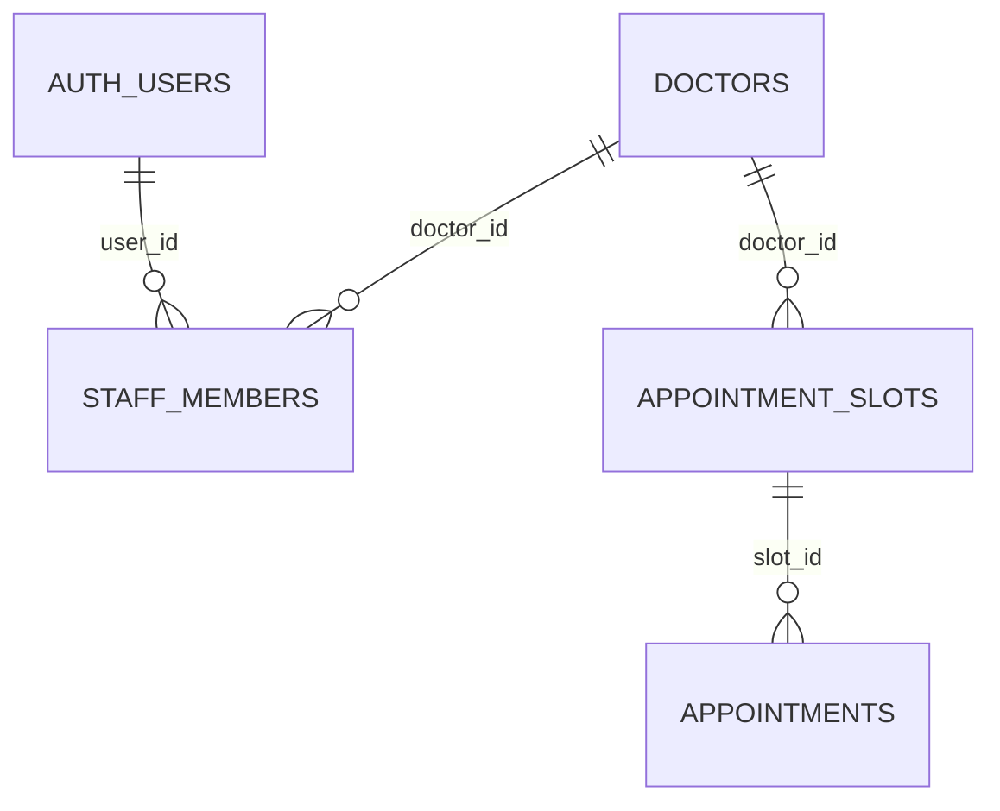

# Quy ước dữ liệu dùng chung FE–BE — 7Scrum v2

**Phiên bản thiết kế:** 2.0 · **Ngày cập nhật:** 04/11/2026 · **Phạm vi:** tài liệu triển khai MVP.

Yêu cầu đã nhận: **bỏ bảng phòng khám và phòng vật lý; bác sĩ có chứng chỉ và rating; quy định rõ status và khóa liên kết**. Bản này cụ thể hóa yêu cầu thành field, kiểu, validation, quyền và quy tắc dữ liệu. Các lựa chọn bổ sung cho MVP được ghi rõ, không coi là nhóm đã duyệt hoặc hệ thống đã chạy.

**Code và DB hiện tại vẫn là v1.** Chưa chạy migration, sửa runtime hoặc deploy trong công việc tài liệu này. [API_CONTRACT.md](API_CONTRACT.md) mô tả API đang có; [API_CONTRACT_V2.md](API_CONTRACT_V2.md) là hợp đồng API đích cùng phiên bản với tài liệu này. Số v2 là phiên bản thiết kế, **không** thêm `/v2` vào URL. Đây là thay đổi không tương thích; FE và BE phải chuyển cùng đợt.

## 1. Cách dùng và phạm vi

- **FE:** dùng tên JSON, type, quy tắc null và trạng thái từ contract v2 để dựng UI/mock.
- **BE:** giữ nguyên tên JSON, thực hiện validation và mapping, kiểm tra quyền trước đọc/ghi.
- **DB:** triển khai kiểu cột, khóa, CHECK/index và giao dịch ở tài liệu này bằng migration mới.
- **BA/QA:** dùng ý nghĩa field, ma trận trạng thái và các ca kiểm tra ở mục 11.
- Nếu source v1 khác tài liệu v2, đó là việc chuyển đổi cần làm, không tự trộn hai phiên bản.

MVP có **4 bảng nghiệp vụ, 29 cột**: `doctors` (12), `appointment_slots` (5), `appointments` (9), `staff_members` (3). `auth.users` thuộc Supabase Auth, không phải bảng do dự án tự tạo. Không có bảng `clinics`, `rooms`, `patients`, `reviews` trong thiết kế đích.

Lựa chọn thiết kế MVP: mỗi bác sĩ có một địa chỉ khám; nhân viên được phân quyền theo bác sĩ; chứng chỉ nằm trong JSONB trên bác sĩ; rating là tổng hợp từ nguồn được quản lý, chưa có chức năng người dùng gửi đánh giá. Không bổ sung thanh toán, đổi lịch, tự hủy bằng mã đặt lịch hoặc CRUD quản trị vào các endpoint hiện hữu.

## 2. Quy ước tên và kiểu dữ liệu

### 2.1. Tên thống nhất

| Thành phần | Quy ước | Ví dụ |
|---|---|---|
| Bảng PostgreSQL | Tiếng Anh, số nhiều, `snake_case` | `doctors`, `appointment_slots` |
| Cột DB, biến/hàm Python | `snake_case` | `doctor_id`, `patient_name` |
| JSON, thuộc tính/biến/hàm TypeScript | `camelCase` | `doctorId`, `patientName` |
| Model Python, type/component FE | `PascalCase` | `BookingInput`, `Doctor`, `BookingClient` |
| Hằng số, biến môi trường | `UPPER_SNAKE_CASE` | `ALLOWED_TRANSITIONS`, `BACKEND_URL` |
| Giá trị enum | Chuỗi tiếng Anh, `snake_case` | `checked_in`, `cancelled` |
| Khóa chính / khóa ngoại | `id` / `<entity>_id` trong DB; `<entity>Id` trong API | `slot_id` ↔ `slotId` |

BE đổi tên tại ranh giới DB–API. Pydantic có thể dùng thuộc tính camelCase như hiện tại hoặc alias rõ ràng; JSON luôn theo camelCase. Không bắt biến cục bộ Python giống FE.

- Type dùng chung: `Doctor`, `Certificate`, `AppointmentSlot`, `StaffAppointment`, `AppointmentStatus`. Danh sách: `doctors`, `slots`, `appointments`.
- `id` là ID đối tượng đang chứa. Doctor dùng `name`; StaffAppointment dùng `doctorName`. Không đổi key chỉ để mọi response giống nhau.
- POST tạo lịch trả `appointmentId`; danh sách staff/PATCH trả `id`. Chúng cùng tham chiếu `appointments.id`.
- Giữ chính xác `usedAI`, `demoMode`, `databaseConfigured`, `ratingCount`; không viết `usedAi`, `doctorID`.
- API v2 không dùng `clinicId`, `clinicName`, `clinicAddress`, `roomId`, `roomName`, `certificate` dạng số ít.
- Không dùng tên, địa chỉ, số điện thoại hoặc mã tham chiếu làm FK.

### 2.2. Kiểu và giá trị rỗng

| Dữ liệu | DB | Python | JSON / TypeScript | Quy tắc |
|---|---|---|---|---|
| ID | `uuid` | `UUID`, chuyển chuỗi khi gọi SDK | `string` | UUID hợp lệ; response dạng chuẩn có dấu gạch nối, chữ thường |
| Văn bản | `text` | `str` | `string` | Chuẩn hóa Unicode NFC, trim đầu/cuối rồi kiểm tra độ dài; giữ khoảng trắng bên trong |
| Điện thoại | `text` | `str` | `string` | Giữ số 0 đầu và dấu `+`; không ép số |
| Thời điểm | `timestamptz` | datetime có timezone hoặc chuỗi SDK | `string` | Input có timezone; response UTC với `Z`, độ chính xác tối đa microsecond |
| Cờ | `boolean` | `bool` | `boolean` | Không nhận `1`, `0` hoặc chuỗi thay cho boolean |
| Rating | `numeric(3,2)` | `Decimal` nội bộ | `number` hoặc `null` | Số hữu hạn, 1–5; xuất JSON number, không phải chuỗi |
| Số đánh giá | `integer` | `int` | `number` | Số nguyên từ 0 đến 2.147.483.647; boolean không phải số hợp lệ |
| Chứng chỉ | `jsonb` | Danh sách model/object đã validate | `Certificate[]` | Mảng, không dùng chuỗi JSON chứa trong chuỗi |

Quy tắc văn bản áp dụng các trường nội dung như name, bio, address, notes, message, filter, issuer. ID/URL/status có parser riêng; không tự đổi case status hoặc sửa URL để biến dữ liệu sai thành đúng. Độ dài văn bản tính theo Unicode code point sau NFC và trim; BE là nơi quyết định. FE cần kiểm tra tương đương (JS `.length` có thể khác với ký tự ngoài BMP).

Response có đủ key đã khai báo trong type; field nullable trả `null`; danh sách trống trả `[]`; văn bản optional nội dung dùng `''` khi quy định như bio/notes. Không trả `undefined`, `"null"` hoặc `{}` thay cho mảng. Optional request nghĩa là được bỏ key; **không đồng nghĩa được gửi null**. Không tự ép number/boolean thành chuỗi. Body v2 từ chối key ngoài schema bằng 422.

Thời gian hiển thị bằng `Asia/Ho_Chi_Minh`; không gửi chuỗi `05/11/2026 09:00` vào dữ liệu thời điểm. DB dùng thời gian server để kiểm tra slot tương lai, không tin đồng hồ FE. `timestamptz` không lưu tên múi giờ địa phương của bác sĩ; timezone hiển thị của MVP là quy ước chung.

## 3. Từ điển đầy đủ từng bảng

**Ký hiệu:** NN = NOT NULL; PK = khóa chính; FK = khóa ngoại; UQ = duy nhất. “Không có” ở default nghĩa DB không tự cấp giá trị. Cột “JSON tương ứng” ghi mapping nếu có, **không phải mọi endpoint đều trả cột đó**; tập field response cụ thể ở API contract v2. Không có giới hạn `varchar(n)` ngầm: cột vẫn là `text`, giới hạn là quy tắc validation/CHECK nêu riêng.

### 3.1. `doctors` — hồ sơ bác sĩ (12 cột)

| Field DB | Kiểu DB | NULL / khóa | Default | JSON tương ứng | Ý nghĩa và quy ước |
|---|---|---|---|---|---|
| `id` | `uuid` | NN, PK | `gen_random_uuid()` | `id: string`; được tham chiếu bằng `doctorId` | Định danh bác sĩ, do DB sinh nếu bên nhập bỏ qua |
| `name` | `text` | NN | Không có | `name: string` | Họ tên hiển thị; 2–100 ký tự |
| `specialty` | `text` | NN | Không có | `specialty: string` | Chuyên khoa; 1–80 ký tự; chưa phải FK hoặc enum |
| `bio` | `text` | NN | `''` | `bio: string` | Giới thiệu; 0–2.000 ký tự; chưa có trả chuỗi rỗng |
| `address` | `text` | NN | Không có | `address: string` | Địa chỉ khám trực tiếp của bác sĩ; 1–300 ký tự |
| `district` | `text` | NN | Không có | `district: string` | Nhãn khu vực dùng lọc; 1–80 ký tự; chưa phải mã hành chính chuẩn |
| `certificates` | `jsonb` | NN | `'[]'::jsonb` | `certificates: Certificate[]` | 0–20 chứng chỉ, cấu trúc ở mục 3.2 |
| `rating` | `numeric(3,2)` | Có NULL | `NULL` | `rating: number \| null` | Điểm trung bình; 1–5 nếu có dữ liệu, NULL nếu chưa có |
| `rating_count` | `integer` | NN | `0` | `ratingCount: number` | Tổng số đánh giá tương ứng với điểm trung bình |
| `active` | `boolean` | NN | `true` | Không trả công khai | Có tiếp nhận đặt lịch mới hay không |
| `created_at` | `timestamptz` | NN | `now()` | Không trả trong MVP | Thời điểm tạo hồ sơ |
| `updated_at` | `timestamptz` | NN | `now()` | Không trả trong MVP | Thời điểm cập nhật; trigger ghi lại mỗi UPDATE |

Một bác sĩ có một địa chỉ khám hiện tại. Nhiều bác sĩ được trùng tên/địa chỉ/chuyên khoa vì các giá trị này không phải định danh. Địa chỉ/district được chuyển từ dữ liệu clinic cũ, không giữ bảng hay FK clinic.

`active = false` chỉ chặn tìm kiếm công khai/đặt lịch mới; không tự hủy lịch, không thu hồi membership, không che lịch đã có khỏi nhân viên. Nhân viên vẫn được xử lý các lịch đó theo ma trận status.

### 3.2. Certificate — cấu trúc phần tử trong `doctors.certificates`

Đây là object nhúng, không thêm bảng thứ năm. Key trong JSONB giữ camelCase giống API.

| Field | Kiểu JSON / FE | Key bắt buộc | Cho null | Quy ước / ý nghĩa |
|---|---|---|---|---|
| `name` | `string` | Có | Không | Tên chứng chỉ/văn bằng; 1–200 ký tự |
| `issuer` | `string` | Có | Không | Đơn vị cấp; 1–200 ký tự |
| `issuedYear` | `number \| null` | Có | Có | Năm cấp nguyên từ 1900 đến năm hiện tại theo `Asia/Ho_Chi_Minh` tại thời điểm nhập hoặc cập nhật |
| `credentialUrl` | `string \| null` | Có | Có | URL HTTPS công khai, tối đa 2.048 ký tự, có hostname, không chứa thông tin đăng nhập; không có thì null |

Không có chứng chỉ thì `[]`; không phần tử null; không thiếu key hoặc key dư; chuỗi rỗng không thay null cho năm/URL. Giữ thứ tự nhập để FE hiển thị. Từ chối phần tử trùng bộ `(name, issuer, issuedYear)` sau chuẩn hóa văn bản, so sánh có phân biệt hoa/thường. Không dùng đồng thời `certificate` và `certificates`.

BE và seed/import dùng cùng validator cho từng phần tử. CHECK JSONB là mảng **không** xác minh key, kiểu, năm hay URL. Kiểm tra năm hiện tại ở luồng ghi, không dùng thời gian thay đổi làm CHECK tĩnh cho JSONB. Tên chứng chỉ/URL không chứng minh đã kiểm định; MVP chưa có field verified, trạng thái duyệt hoặc upload.

### 3.3. Quy tắc rating

| Tình huống | `rating` | `rating_count` | Hợp lệ |
|---|---|---|---|
| Chưa có dữ liệu đánh giá | `NULL` | `0` | Có; UI ghi “Chưa có đánh giá” |
| Có dữ liệu tổng hợp | Từ `1.00` đến `5.00` | Từ `1` đến `2147483647` | Có nếu có nguồn tương ứng |
| Chưa có điểm nhưng count dương | `NULL` | `> 0` | Không |
| Có điểm nhưng count bằng 0 | Bất kỳ số | `0` | Không |
| Điểm 0/ngoài khoảng/NaN/Infinity | Không hợp lệ | Bất kỳ | Không |

Nếu có dữ liệu gốc: tính tổng điểm / số đánh giá bằng Decimal, làm tròn 2 chữ số theo **ROUND_HALF_UP**; 4.345 → 4.35. Không tính điểm mới bằng trung bình của các trung bình đã làm tròn. Nguồn chỉ cung cấp trung bình/count thì nhập như snapshot, không giả định có từng review hoặc ghép nguồn thiếu dữ liệu gốc.

Cập nhật rating/count cùng giao dịch. Nguồn, ngày lấy và bằng chứng nhập ghi trong hồ sơ seed/import của nhóm; schema chưa lưu provenance trong cột riêng. Chưa có nguồn thì NULL/0. Chưa có API review/public sửa điểm; nhân viên quản lý lịch cũng không được sửa điểm qua API hiện hữu.

Nhập snapshot chỉ nhận số hữu hạn chính xác tới tối đa 2 chữ số thập phân; từ chối 4.999 trước DB. `numeric(3,2)` có thể **tự làm tròn** trước CHECK nên không thay validator. Pydantic serialize Decimal phải cấu hình rõ JSON number vì mặc định có thể ra string. `4.5` và `4.50` là cùng một số hợp lệ. [PostgreSQL numeric](https://www.postgresql.org/docs/current/datatype-numeric.html), [Pydantic Decimal](https://docs.pydantic.dev/latest/api/standard_library_types/#decimals).

### 3.4. `appointment_slots` — khung giờ khám (5 cột)

| Field DB | Kiểu DB | NULL / khóa | Default | JSON tương ứng | Ý nghĩa và quy ước |
|---|---|---|---|---|---|
| `id` | `uuid` | NN, PK | `gen_random_uuid()` | `id: string`; booking dùng `slotId` | ID khung giờ, không phải ID lịch hẹn |
| `doctor_id` | `uuid` | NN, FK → `doctors.id` | Không có | `doctorId: string` | Bác sĩ phụ trách duy nhất |
| `start_at` | `timestamptz` | NN | Không có | `startAt: string` | Bắt đầu; phải lớn hơn thời điểm server khi đặt |
| `end_at` | `timestamptz` | NN | Không có | `endAt: string` | Kết thúc, lớn hơn start_at |
| `is_published` | `boolean` | NN | `true` | Không trả trong Slot | Công bố cho đặt lịch; false không hiện trong danh sách slot công khai |

Không còn clinic_id/room_id. Thời điểm hữu hạn, không nhận infinity. Slot quá giờ giữ để lưu lịch sử nhưng không đặt mới được. Không cho hai khoảng cùng doctor giao nhau, kể cả slot chưa công bố. Khoảng **[start, end)** cho phép 09:00–09:30 liền kề 09:30–10:00. Khác doctor được trùng giờ. Exclusion constraint + GiST/`btree_gist` bảo vệ ở DB; unique giờ bắt đầu một mình không đủ. [PostgreSQL ranges](https://www.postgresql.org/docs/current/rangetypes.html#RANGETYPES-CONSTRAINT).

Ẩn slot không tự hủy lịch cũ. Không đổi doctor_id/start_at/end_at của slot đã có bất kỳ appointment nào, kể cả đã hủy; tạo slot mới nếu cần. Không đổi appointments.slot_id để chuyển lịch ngầm.

### 3.5. `appointments` — lịch hẹn (9 cột)

| Field DB | Kiểu DB | NULL / khóa | Default | JSON tương ứng | Ý nghĩa và quy ước |
|---|---|---|---|---|---|
| `id` | `uuid` | NN, PK | `gen_random_uuid()` | `appointmentId: string` khi tạo; `id: string` ở staff/PATCH | Định danh lịch hẹn |
| `slot_id` | `uuid` | NN, FK → `appointment_slots.id` | Không có | `slotId: string` | Khung giờ đã chọn; bất biến sau tạo |
| `patient_name` | `text` | NN | Không có | `patientName: string` | Họ tên; sau NFC/trim có 2–100 ký tự |
| `patient_phone` | `text` | NN | Không có | `patientPhone: string` | Quy tắc điện thoại bên dưới; lưu chuỗi trim |
| `notes` | `text` | NN | `''` | Booking request `notes?: string` | 0–500 ký tự; bỏ key → ''; không nhận null |
| `status` | `text` | NN, CHECK | `'requested'` | `status: AppointmentStatus` | 5 giá trị mục 4; không dùng PostgreSQL ENUM |
| `booking_reference` | `text` | NN, UQ | `upper(left(replace(gen_random_uuid()::text, '-', ''), 12))` | `bookingReference: string` | Mã hex 12 ký tự in hoa, DB sinh; không phải khóa cấp quyền |
| `created_at` | `timestamptz` | NN | `now()` | Không trả trong MVP | Thời điểm tạo, dùng sắp xếp staff |
| `updated_at` | `timestamptz` | NN | `now()` | Không trả trong MVP | Trigger ghi mỗi UPDATE; không phải token phiên bản |

**Điện thoại v2:** regex `^\+?[0-9 ()-]{9,20}$` sau trim, đồng thời phải có **ít nhất 9 chữ số ASCII 0–9**. Phần sau dấu + optional có 9–20 ký tự; tổng có thể 21 ký tự khi có +. Giữ dấu cách/ngoặc/gạch nối bên trong. Điều kiện chữ số bổ sung để chặn chuỗi chỉ có dấu phân cách, là cải tiến so với v1. Chưa có OTP/xác minh số thật.

Một slot tối đa một appointment **khác cancelled**. requested/confirmed/checked_in/completed đều chiếm slot; lịch hủy không chiếm slot. Không nhầm quy tắc này với doctors.active. Patient không cần tài khoản/FK; không lưu doctor_id lặp trong appointment vì suy ra duy nhất qua slot.

### 3.6. `staff_members` — quyền nhân viên theo bác sĩ (3 cột)

| Field DB | Kiểu DB | NULL / khóa | Default | JSON tương ứng | Ý nghĩa và quy ước |
|---|---|---|---|---|---|
| `user_id` | `uuid` | NN, PK ghép, FK → `auth.users.id` | Không có | Không trả API | User Supabase Auth; không lưu email/password tại đây |
| `doctor_id` | `uuid` | NN, PK ghép, FK → `doctors.id` | Không có | Không trả API | Bác sĩ user được quản lý lịch |
| `created_at` | `timestamptz` | NN | `now()` | Không trả API | Thời điểm cấp membership |

PK (user_id, doctor_id), không trùng cặp. Một user quản lý nhiều doctor và ngược lại. Không có role/staff_id/clinic_id. Mọi membership cùng quyền đọc/chuyển status lịch doctor được gán; không có quyền quản trị hồ sơ, chứng chỉ, slot hoặc điểm qua API MVP.

## 4. Status cố định và bước chuyển

### 4.1. AppointmentStatus

| Giá trị chính xác | Nhãn UI | Ý nghĩa | Được chuyển sang |
|---|---|---|---|
| `requested` | Chờ xác nhận | Đã lưu yêu cầu, slot đã được giữ ở DB | `confirmed`, `cancelled` |
| `confirmed` | Đã xác nhận | Nhân viên xác nhận yêu cầu | `checked_in`, `cancelled` |
| `checked_in` | Đã đến khám | Người bệnh đã tới, được ghi nhận | `completed`, `cancelled` |
| `completed` | Hoàn tất | Buổi khám kết thúc | Không có |
| `cancelled` | Đã hủy | Lịch bị hủy | Không có |

Ma trận toàn bộ bước chuyển: ✓ cho phép; — bị chặn. Những giá trị thuộc schema PATCH nhưng sai bước trả 409.

| Từ / đến | requested | confirmed | checked_in | completed | cancelled |
|---|---|---|---|---|---|
| requested | — | ✓ | — | — | ✓ |
| confirmed | — | — | ✓ | — | ✓ |
| checked_in | — | — | — | ✓ | ✓ |
| completed | — | — | — | — | — |
| cancelled | — | — | — | — | — |

- POST luôn do DB gán requested; body có status là key dư →422.
- PATCH chỉ `{status}`, input là confirmed/checked_in/completed/cancelled. Gửi requested/pending/done/canceled hoặc enum lạ →**422**, trước khi xét chuyển trạng thái. Requested trong ma trận không phải input PATCH hợp lệ.
- PATCH cùng status hoặc sai thứ tự →409; không chuyển lùi/mở lại trạng thái kết thúc.
- Chỉ nhân viên có membership tương ứng được PATCH; bệnh nhân chưa có chức năng tự hủy/xác nhận.
- Được hủy sau check-in. Chưa có no_show, lý do hủy, actor, thời điểm check-in/xác nhận riêng hay lịch sử chuyển status. Timestamp không thay audit log.
- Không tự chuyển status hoặc tự giải phóng requested theo thời gian. Requested chiếm slot đến khi được xử lý; quá giờ chỉ làm slot không đặt mới được.
- Hủy chỉ cho đặt lại nếu slot còn tương lai, công bố và doctor active.
- PATCH chưa có điều kiện “đã đến giờ khám”. Nhân viên ghi nhận đúng thực tế; slot quá giờ/doctor inactive không chặn xử lý lịch cũ.

### 4.2. Cờ và status khác

| Field | Giá trị | Ý nghĩa |
|---|---|---|
| `doctors.active` | true / false | Nhận/ngừng nhận lịch mới |
| `appointment_slots.is_published` | true / false | Công bố/ẩn slot |
| `demoMode` | true / false | Dữ liệu minh họa trong catalog/slots |
| `usedAI` | true / false | Có dùng kết quả trích xuất filter từ AI |
| `urgent` | true / false | Nhánh thông báo tình huống khẩn cấp |
| Health `status` | `"ok"` | Endpoint health trả được response |
| `databaseConfigured` | true / false | Có cấu hình DB, không chứng minh kết nối thành công |

Không tạo thêm status doctor/slot khi hai cờ đã đủ. Health status không thuộc AppointmentStatus. Urgent có thể trả demoMode false vì không truy vấn catalog; không suy ra DB đã kết nối.

## 5. Khóa liên kết, cardinality và quyền



| Tên FK đích | Cột con → khóa tham chiếu | ON DELETE | ON UPDATE | Ý nghĩa |
|---|---|---|---|---|
| `appointment_slots_doctor_id_fkey` | `appointment_slots.doctor_id` → `doctors.id` | RESTRICT | RESTRICT | Không xóa/đổi ID doctor khi còn slot |
| `appointments_slot_id_fkey` | `appointments.slot_id` → `appointment_slots.id` | RESTRICT | RESTRICT | Không xóa/đổi ID slot khi còn lịch, kể cả hủy |
| `staff_members_user_id_fkey` | `staff_members.user_id` → `auth.users.id` | CASCADE | RESTRICT | Xóa user thì xóa quyền, không xóa lịch |
| `staff_members_doctor_id_fkey` | `staff_members.doctor_id` → `doctors.id` | RESTRICT | RESTRICT | Không xóa doctor khi còn membership |

Doctor 1–N slot; slot 1–N appointment về lịch sử nhưng tối đa một lịch chưa hủy; user N–N doctor qua membership. Mỗi bản ghi con có đúng một cha vì FK NN. Doctor không bắt buộc có slot/membership ngay khi tạo.

**Phân quyền:** verify Bearer token → user ID → membership doctor → join appointment → slot → doctor. Staff chỉ đọc lịch doctor được gán, kể cả doctor inactive. PATCH kiểm tra doctor của chính lịch, không tin doctor ID FE gửi thêm.

Không membership →403; membership doctor A không cấp quyền doctor B. Thiếu/token sai →401; hạ tầng DB/Auth lỗi →503, không quy mọi lỗi thành token sai. Kiểm tra quyền mỗi request. Xóa membership thu hồi quyền cho thao tác mới, không đổi lịch hoặc user Auth.

Bốn bảng bật RLS, không thêm policy cho anon/authenticated đọc/ghi trực tiếp dữ liệu nghiệp vụ. Route qua BE dùng service-role nên **BE phải kiểm tra quyền**; không xem RLS tự giới hạn service-role. Chỉ quy trình quản trị tin cậy được cấp quyền/seed, không có public endpoint thêm membership.

## 6. Ràng buộc DB và nơi chịu trách nhiệm

### 6.1. Danh sách bắt buộc cho migration

| Tên / nhóm | Nội dung |
|---|---|
| PK | `doctors_pkey(id)`, `appointment_slots_pkey(id)`, `appointments_pkey(id)`, `staff_members_pkey(user_id, doctor_id)` |
| 4 FK | Theo mục 5, UUID, không nối clinic/room |
| `doctors_rating_consistency_check` | SQL bên dưới; count không âm, có điểm thì count dương |
| `doctors_certificates_array_check` | JSONB array, ≤20 phần tử; CASE để không gọi array_length trên giá trị sai kiểu |
| Giới hạn text | CHECK char_length theo từ điển cho doctor/patient_name/notes; chuẩn hóa ở luồng ghi |
| `appointments_patient_phone_check` | Regex và ít nhất 9 chữ số ASCII |
| `appointments_status_check` | status IN ('requested','confirmed','checked_in','completed','cancelled') |
| `appointments_booking_reference_key` | UQ booking_reference |
| `appointments_booking_reference_format_check` | booking_reference ~ '^[0-9A-F]{12}$' |
| `appointment_slots_time_check` | Hai thời điểm hữu hạn, end_at > start_at |
| `appointment_slots_doctor_start_key` | UQ (doctor_id, start_at) |
| `appointment_slots_no_overlap` | Exclusion GiST (doctor_id WITH =, tstzrange(start_at, end_at, '[)') WITH &&), mọi slot |
| `appointments_one_active_per_slot` | Partial unique (slot_id) WHERE status <> 'cancelled' |
| Timestamp triggers | updated_at = now() mỗi UPDATE doctors/appointments; created_at bất biến sau INSERT |

Tên trên là đích đề xuất cho migration/xử lý lỗi, chưa phải constraint đã tạo. Giữ unique doctor/start để nhận diện trùng giờ; exclusion bảo vệ cả khoảng giao nhau. Không dựa vào SELECT trước INSERT của FE/BE để chống đặt trùng. CHECK chấp nhận NULL khi biểu thức UNKNOWN nên cần NN/nhánh NULL rõ ràng. [PostgreSQL constraints](https://www.postgresql.org/docs/current/ddl-constraints.html).

SQL minh họa hai CHECK (không phải migration đã chạy):

```sql
CHECK (
  (rating IS NULL AND rating_count = 0)
  OR
  (rating IS NOT NULL AND rating BETWEEN 1 AND 5 AND rating_count > 0)
);

CHECK (
  CASE WHEN jsonb_typeof(certificates) = 'array'
    THEN jsonb_array_length(certificates) <= 20
    ELSE false
  END
);
```

Rating CHECK cộng rating_count NN đã loại count âm; có thể thêm CHECK count riêng cho lỗi dễ đọc. DEFAULT chỉ áp dụng khi bỏ cột, không thay explicit NULL cho cột NN.

### 6.2. Validation theo lớp

| Quy tắc | FE | BE / seed / import | DB |
|---|---|---|---|
| Độ dài, phone, required | Báo sớm | Bắt buộc sau chuẩn hóa | NN/CHECK bổ trợ |
| Certificate, key dư, năm/URL | Render; validate nếu có màn nhập sau này | Bắt buộc mọi đường nhập | CHECK array/count, chưa kiểm tra sâu phần tử |
| Rating/count/max 2 số lẻ | Chỉ đọc | Bắt buộc trước cast DB | Numeric + CHECK điểm/count |
| Bước chuyển status | Nút hợp lệ | Bắt buộc trong giao dịch | CHECK tập giá trị, không tự kiểm tra bước chuyển |
| Quyền | Ẩn UI chưa đủ | Token/membership tại thao tác | RLS/FK không thay giới hạn service-role |
| Tương lai/active/công bố | Theo response | Kiểm tra lại lúc đặt | Khóa + unique |
| Khoảng giờ không giao nhau | Không suy đoán | Báo lỗi từ DB | Exclusion |
| Bất biến slot/giờ có lịch | Không có UI đổi trong MVP | Quản trị/transaction kiểm tra | FK không tự chặn đổi sang giá trị hợp lệ khác |

Direct SQL service-role có thể bypass quy tắc BE. Seed/import phải dùng validator và review; không khẳng định DB tự bảo vệ toàn bộ Certificate hoặc lịch sử thay đổi khi chưa có trigger tương ứng.

### 6.3. Index truy vấn

Ngoài index do PK/UQ/exclusion tự tạo, cần `staff_members(doctor_id)` cho quyền theo doctor/FK và `appointments(created_at DESC, id DESC)` cho staff. Unique doctor/start và PK ghép membership phục vụ truy vấn tiền tố tương ứng, không tạo index lặp. Partial unique slot không bao phủ lịch hủy: thêm index đầy đủ `appointments(slot_id)` cho join lịch sử/kiểm tra bất biến slot.

## 7. Giao dịch đặt lịch, cập nhật và bất biến

### 7.1. Đặt lịch

1. BE validate BookingInput; không nhận doctor ID/status từ FE để quyết định quan hệ.
2. RPC thao tác DB nguyên tử, đọc/khóa doctor rồi slot theo thứ tự nhất quán; đọc lại quan hệ/điều kiện sau lấy khóa. MVP có thể khóa hàng FOR UPDATE theo doctor → slot để đơn giản đồng bộ.
3. Kiểm tra doctor active, slot thuộc doctor đã khóa và đã công bố. `start_at` phải lớn hơn `clock_timestamp()` tại lúc kiểm tra sau khi lấy khóa. `now()` giữ thời điểm bắt đầu transaction nên có thể cũ nếu đã chờ khóa.
4. INSERT appointment default requested; partial unique chống đặt trùng ở lớp cuối. Trả ID/reference chỉ sau transaction thành công.
5. Slot không tồn tại/không đủ điều kiện hoặc unique slot conflict →409. Hạ tầng không sẵn sàng →503. Không booking thành công giả.

Luồng tắt doctor/ẩn slot/đổi địa chỉ cũng phải phối hợp cùng thứ tự khóa và kiểm tra. Không khóa toàn bộ doctors. Xử lý deadlock/rollback ở BE, không trả raw SQL cho FE. Khóa hàng giữ đến hết transaction. [PostgreSQL row locks](https://www.postgresql.org/docs/current/explicit-locking.html#LOCKING-ROWS).

**Unique violation:** xung đột appointments_one_active_per_slot →409. Xung đột appointments_booking_reference_key là mã ngẫu nhiên trùng, không phải slot đã bị chiếm: sinh mã khác và thử tối đa **3 lần thử tổng cộng** bằng subtransaction/savepoint; hết lượt →503. Không gom mọi SQLSTATE23505 thành slot unavailable.

### 7.2. RPC và staff update

| Field RPC `create_appointment` | Hướng | Kiểu SQL | Nguồn / quy tắc |
|---|---|---|---|
| `p_slot_id` | Vào | uuid | slotId, bắt buộc |
| `p_patient_name` | Vào | text | patientName, chuẩn hóa/validate như API |
| `p_patient_phone` | Vào | text | patientPhone, chuẩn hóa/validate như API |
| `p_notes` | Vào | text | notes, default ''; không nhận explicit NULL trong contract v2 |
| `appointment_id` | Ra | uuid | BE map appointmentId |
| `booking_reference` | Ra | text | BE map bookingReference |

RPC trả một hàng khi thành công; tên SQL không phải JSON FE. EXECUTE chỉ service-role, search_path cố định; bỏ mọi JOIN clinic/room. Không ghi status tùy ý. Validation RPC sai từ BE là lỗi triển khai; không báo nhầm mọi P0001 thành hết slot, cần phân biệt lỗi có cấu trúc.

Staff PATCH verify token, xác định appointment/doctor, kiểm tra membership **tại giao dịch ghi**, đọc status và xét ma trận. Khóa doctor → slot → appointment khi lấy nhiều khóa; không đảo thứ tự giữa thao tác. Thu hồi quyền đồng thời: kiểm tra/giữ khóa membership cùng giao dịch để không bị gỡ giữa kiểm tra và ghi. Request đã giữ quyền có thể hoàn tất; request sau thu hồi phải bị chặn.

UPDATE có điều kiện status cũ; không ghi đè status đã đổi. Không có hàng update vì đổi đồng thời →409, FE tải lại. Không chỉ đọc membership ở BE rồi ghi bằng nhiều request service-role rời mà bỏ qua thu hồi. SQL/RPC PATCH là việc phải triển khai, code v1 chưa được coi là đã đảm bảo điều này.

### 7.3. Lịch sử và giới hạn

- ID và appointments.slot_id bất biến; created_at không đổi. Slot có lịch không đổi doctor/start/end.
- Chưa có DELETE appointment, kể cả canceled; hủy bằng status.
- Không xóa doctor có slot/membership; ngừng nhận mới bằng active false. Gỡ membership không xóa lịch.
- Không đổi address/district khi doctor còn lịch tương lai chưa hủy; quy trình quản trị khóa/kiểm tra trước UPDATE và xử lý lịch liên quan trước.
- Chưa lưu snapshot tên/địa chỉ tại lúc đặt; lịch sử join ra thông tin hiện tại. Cần snapshot sau nếu nghiệp vụ đòi chứng từ lịch sử chính xác.
- Chưa có idempotency key: timeout POST có thể đã ghi nhưng FE chưa nhận. Không retry liên tục hoặc báo chắc chắn thất bại; xem hành vi FE trong API v2.

## 8. Đồng bộ API, demo và cấu hình

Doctor có 9 field công khai, AppointmentSlot có 4 field và StaffAppointment có 8 field. BE chọn đúng các trường cho từng response theo quyền. Request, response, type TypeScript và JSON mẫu nằm trong [API contract v2](API_CONTRACT_V2.md).

DoctorSearchFilters trong **response v2** có đủ specialty/district/keyword, mỗi giá trị string hoặc null. Urgent trả cả ba null, không trả {}. Query vẫn optional. Đây là thay đổi so với urgent v1, cần sửa type/UI đồng thời.

Demo catalog/slots dùng dữ liệu giả →demoMode true, FE tắt booking. Không cấu hình DB →POST503. Có cấu hình nhưng DB lỗi →503, không âm thầm tráo demo/thành công giả. Không AI key/AI lỗi thì fallback trích xuất từ khóa; AI không tạo record bác sĩ/chứng chỉ/rating/lịch đặt.

| Biến môi trường | Nơi dùng | Kiểu / ý nghĩa |
|---|---|---|
| `BACKEND_URL` | Server Next.js | URL BE, không thêm hậu tố /api |
| `NEXT_PUBLIC_SUPABASE_URL` | FE | URL Supabase cho Auth |
| `NEXT_PUBLIC_SUPABASE_ANON_KEY` | FE | Public anon key, không phải quyền đọc lịch |
| `SUPABASE_URL` | BE | URL Supabase |
| `SUPABASE_SERVICE_ROLE_KEY` | Chỉ BE | Secret server, không đưa vào browser |
| `OPENAI_API_KEY` | Chỉ BE | Secret AI tùy chọn |
| `OPENAI_MODEL` | BE | Chuỗi model, default xem .env.example |
| `CORS_ORIGINS` | BE | Các origin phân cách dấu phẩy |

Staff dùng Authorization: Bearer <access_token>; access_token là key SDK Supabase, không đổi khi đọc session. Không lưu password/token vào bảng nghiệp vụ hoặc đưa patient payload/token vào log chia sẻ.

## 9. Chuyển v1 → v2 không mất dữ liệu/quyền

Đây là kế hoạch, chưa thực thi. Giữ migration 001_init.sql, tạo migration mới khi triển khai.

1. **Backup và audit:** chụp schema/data/quyền; thống kê doctor/slot/appointment/membership, orphan, overlap, text quá dài, phone không đạt v2. Không tự xóa/cắt văn bản/sửa lịch để ép pass.
2. **Kiểm tra khóa cũ:** appointment_slots.clinic_id phải khớp clinic của doctor; audit room/clinic cũ trước loại bỏ. Dữ liệu lệch cần xử lý rõ vì quyền cũ theo clinic của slot, quyền mới theo doctor.
3. **Cột doctor mới:** copy address/district từ clinic, giữ ID. **active mới = doctor.active cũ AND clinic.active cũ** để không mở lại doctor của clinic ngừng hoạt động. certificates [], rating NULL/count0 khi chưa có nguồn; không tự suy ra điểm/chứng chỉ.
4. **Membership:** mỗi user/clinic cũ → từng doctor của clinic; deduplicate user/doctor; giữ quyền doctor inactive để đọc lịch cũ. Clinic không doctor không sinh quyền toàn hệ thống; ghi nhận cặp không ánh xạ và kiểm tra với nhóm. created_at membership mới lấy thời điểm migration vì bảng cũ không có cột này.
5. **Ràng buộc:** giữ ID slot/appointment, slot_id, status, reference, timestamp hiện hữu; audit overlap trước exclusion. Không tự dời/xóa slot có lịch/hủy appointment để giải quyết xung đột. Rà phone/rating/certificates trước CHECK.
6. **Chuẩn bị source v2:** FE/BE/seed/RPC trên môi trường thử nghiệm/schema trung gian; biết code nào còn đọc cột cũ trước bỏ.
7. **Cutover phối hợp:** chặn ghi trong cửa sổ chuyển hoặc dùng chiến lược tương thích đã kiểm tra; đối chiếu dữ liệu/quyền/booking rồi đổi FE–BE cùng đợt. Không để v1 ghi khi chuyển quyền.
8. **Bỏ phụ thuộc cũ sau xác nhận:** doctors.clinic_id; appointment_slots.clinic_id/room_id; staff_members.clinic_id; FK/index/policy liên quan; rooms/clinics. Kiểm tra RPC/view/seed/query trước DROP, không DROP CASCADE không kiểm soát.
9. **Sau chuyển:** số lịch/ID không đổi; quyền đúng mapping; active không bị mở lại; concurrency/auth/UI pass và lưu bằng chứng. Rollback phải tính dữ liệu mới sau cutover, không chỉ deploy code v1 lên schema v2 đã bỏ cột.

## 10. File triển khai và trách nhiệm

| Thành phần | Nơi sửa khi triển khai v2 | Nội dung |
|---|---|---|
| Schema/seed | supabase/migrations (mới), supabase/seed.sql | 4 bảng, ràng buộc/trigger, chuyển dữ liệu/quyền |
| Mapping/quyền | backend/app/service.py | Bỏ JOIN clinic/room; doctor-scope staff; đủ field/giao dịch |
| Validation/status | backend/app/schemas.py | Model request/response, extra forbid, chuẩn hóa, enum/transitions |
| Routes | backend/app/main.py | URL giữ nguyên, response model và lỗi |
| Assistant | backend/app/assistant.py | Tìm name/specialty/address/district; filters đủ key; bỏ clinic keyword |
| Demo | backend/app/demo.py | ID slot không trùng giữa doctor; field v2; chứng chỉ/rating giả ghi rõ |
| FE types | frontend/src/lib/types.ts | Type API v2; bỏ type Row trùng cục bộ |
| FE UI | frontend/src/app/page.tsx, booking/staff pages | Address/chứng chỉ/rating; bỏ clinic/room; state/lỗi/payload |
| Test | backend/tests và QA integration | Fixture v2; runtime/concurrency thật có bằng chứng riêng |
| Tài liệu nhóm | USER_STORIES, DoD, workflow, release checklist | Đồng bộ scope doctor, giữ lịch sử/evidence, không tự đánh dấu nghiệm thu |

Tech Lead quản lý API/schema; FE/BE cùng tham chiếu tên field; BA quản lý ý nghĩa, QA xác minh. Đổi field phải ghi tên/kiểu/null/default/validation/tác động, sửa dictionary/type/mapping cùng PR. TEAM_WORKFLOW yêu cầu reviewer Dev Team có tên xác nhận AI draft trong PR/issue; chưa tự ghi reviewer/PO acceptance là hoàn tất.

## 11. Ma trận kiểm tra tối thiểu cho bản triển khai

Đây là tiêu chí phải chạy sau khi có code v2, không phải kết quả đã pass.

| ID | Tình huống | Kết quả bắt buộc |
|---|---|---|
| DATA-01 | Doctor/Slot/Staff response | Đủ key/type, không clinic/room |
| DATA-02 | certificates rỗng/nhiều phần tử | [] hoặc mảng đúng, không chuỗi JSON |
| DATA-03 | Certificate thiếu/dư key, null phần tử, URL/năm sai, >20, trùng bộ | Luồng nhập từ chối; CHECK array không thay validator sâu |
| DATA-04 | Rating NULL/count0 hoặc 4.35/count12 | Hợp lệ, rating JSON number/null |
| DATA-05 | NULL/count1, rating4/count0, âm, >5, count bool, 4.999 snapshot | Từ chối đúng lớp |
| DATA-06 | Whitespace, Unicode tổ hợp, quá dài | NFC/trim rồi validate |
| DATA-07 | Phone có 0 đầu/+; toàn dấu/ngoặc, số JSON, thiếu chữ số | Giữ chuỗi hợp lệ, sai422 |
| DATA-08 | Bỏ notes, notes null, body key dư | Bỏ→''; null/key dư→422 |
| KEY-01 | FK orphan, membership trùng | DB từ chối |
| KEY-02 | Xóa doctor có slot/membership, xóa slot có lịch | RESTRICT, không mất lịch |
| KEY-03 | Xóa user Auth | Membership bị xóa, lịch không đổi |
| SLOT-01 | Slot cùng doctor giao nhau | DB từ chối, kể cả chưa công bố |
| SLOT-02 | Liền kề/khác doctor trùng giờ | Được phép |
| SLOT-03 | Doctor không có/inactive | Public detail/slots404; booking không đủ điều kiện409 |
| SLOT-04 | Doctor active không slot | 200, slots[] |
| BOOK-01 | Hai request cùng slot | Một201, bên còn409, một lịch chưa hủy |
| BOOK-02 | Slot quá giờ/ẩn hoặc doctor tắt trong khi chờ | Kiểm tra lại sau khóa, không đặt sai điều kiện |
| BOOK-03 | Hủy rồi đặt lại | Chỉ khi slot đủ điều kiện, giữ lịch hủy |
| BOOK-04 | Reference collision | Retry có giới hạn, không báo slot occupied sai |
| STATUS-01 | Mọi cặp ma trận | Đúng 6 chuyển hợp lệ; input requested/enum lạ422, sai bước/cùng status409 |
| STATUS-02 | Hai PATCH mâu thuẫn đồng thời | Không ghi đè stale status, conflict tải lại |
| AUTH-01 | Thiếu token/token sai/hạ tầng Auth lỗi | 401/401/503 |
| AUTH-02 | User quản lý A truy cập lịch B | Không lộ lịch B; PATCH403 |
| AUTH-03 | Thu hồi quyền đồng thời | Request sau thu hồi bị chặn; đã giữ quyền có thể hoàn tất |
| AUTH-04 | Doctor inactive/slot ẩn có lịch | Staff vẫn xử lý theo quyền, không tự hủy |
| LIST-01 | >100, filter match ngoài 100 đầu | Filter/quyền trước limit, thứ tự ổn định |
| DEMO-01 | Không DB/DB lỗi/AI lỗi/urgent | Không booking giả, flags/filter đúng |
| MIG-01 | Clinic inactive/lệch slot clinic/quyền trùng/overlap | Audit trước chuyển, không mở quyền/active sai hoặc mất dữ liệu |

## 12. Nguồn và giới hạn xác minh

- Source v1: backend/app/schemas.py, main.py, service.py, assistant.py, demo.py; frontend/src/lib/types.ts; supabase/migrations/001_init.sql. Dùng nhận diện phần chuyển, không coi schema v1 là đích.
- PostgreSQL chính thức: [constraints](https://www.postgresql.org/docs/current/ddl-constraints.html), [range/exclusion](https://www.postgresql.org/docs/current/rangetypes.html), [row locks](https://www.postgresql.org/docs/current/explicit-locking.html), [numeric](https://www.postgresql.org/docs/current/datatype-numeric.html).
- Pydantic chính thức: [standard types/Decimal serialization](https://docs.pydantic.dev/latest/api/standard_library_types/). Kiểm tra serializer theo phiên bản thực tế của dự án.

Đã rà tính nhất quán tài liệu; chưa chạy migration/test DB v2, auth live hoặc UI v2. Phiên bản PostgreSQL/extension thực tế của Supabase đích cần kiểm tra khi áp dụng migration.
